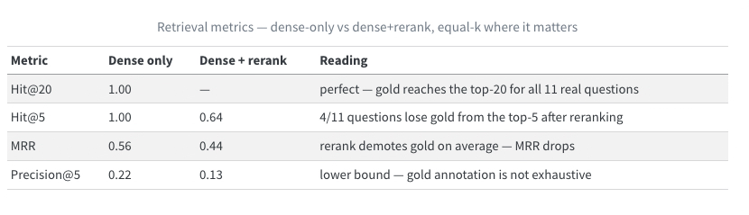
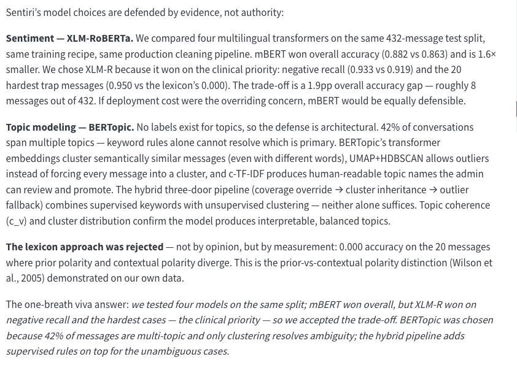
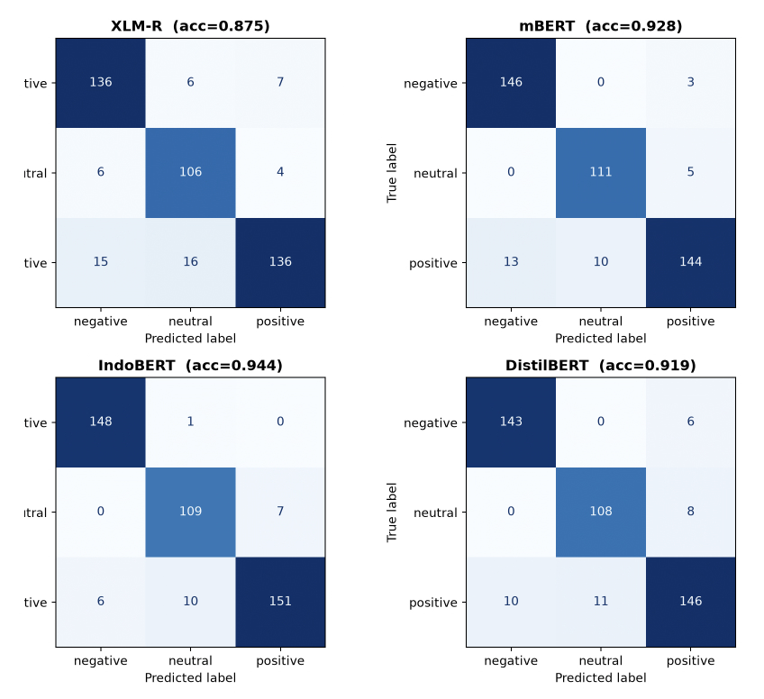

# Sentiri — Model & RAG Evaluation

Evaluation artifacts for **Sentiri**, an autism-clinic chat analyzer (FYP, UPNM).
Two measured systems live here:

1. **Model evaluation** — XLM-RoBERTa sentiment fine-tune + BERTopic topic modeling
2. **RAG evaluation** — retrieval metrics for the clinic knowledge chatbot

**Full write-ups (Quarto, journal-styled):**

- `model_evaluation.qmd` — model choice rationale, confusion matrix, topic clusters
- `rag_evaluation.qmd` — gold set, retrieval metrics, failure analysis, improvement plan

---

## Headline results

### RAG retrieval — the reranker regression

A 13-question gold set (11 real, 2 adversarial) scored with hand-written
hit@k, MRR, and precision@k. Headline: **dense retrieval alone is at ceiling;
the cross-encoder rerank stage strictly degrades it at equal k.**

| Metric | Dense only | Dense + rerank |
|---|---:|---:|
| Hit@20 | **1.00** | — |
| Hit@5 | **1.00** | 0.64 |
| MRR | **0.56** | 0.44 |
| Precision@5 | **0.22** | 0.13 |



Evidence-driven next step: swap `ms-marco-MiniLM` (English-trained) for a
multilingual reranker (BGE-m3 family) or gate/remove the rerank stage —
the harness makes this a one-line change plus a 37-second re-run.
BM25 hybrid search was **considered and deferred**: hit@20 = 1.00 means the
lexical-miss failure mode it fixes does not occur in this gold set.

### Model evaluation — sentiment & topics





---

## Repo layout

```
model_evaluation.qmd   # sentiment model + topic modeling write-up
rag_evaluation.qmd     # RAG retrieval eval write-up
gold_set_rag.json      # 13-question gold set (frozen)
scripts/
  rag_evaluation.py    # hand-written metrics: hit@k, MRR, precision@k
rag_eval_results.json  # full run evidence (ranked ids + scores, re-computable)
media/                 # snapshots
```

## Reproduce

```zsh
# Quarto site (renders from saved JSON — never re-runs the pipeline)
export PATH="/Users/apple/degree/finalyearengineredo/venv/bin:$PATH"
quarto preview

# RAG retrieval eval (~37 s, needs the Sentiri repo + Chroma collection)
../finalyearengineredo/venv/bin/python scripts/rag_evaluation.py
```
